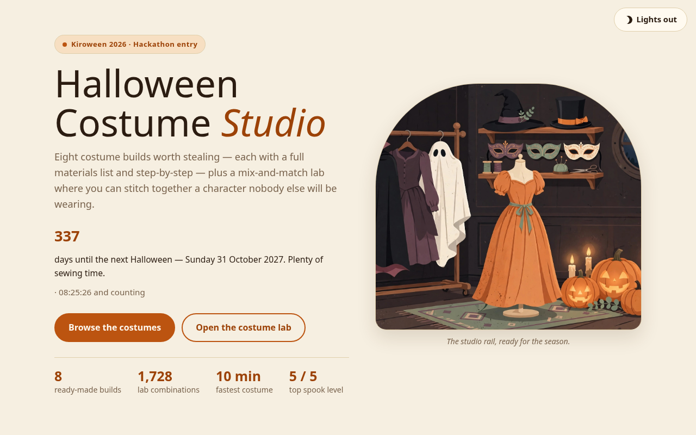
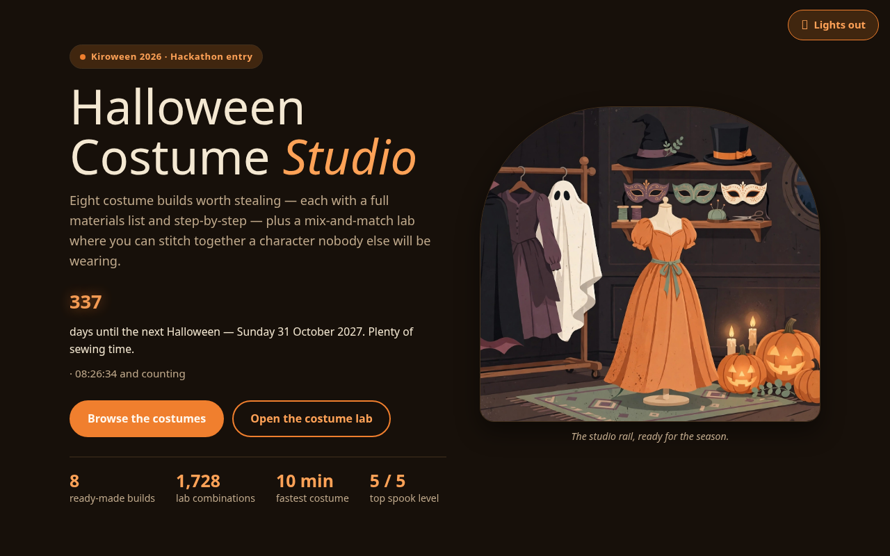
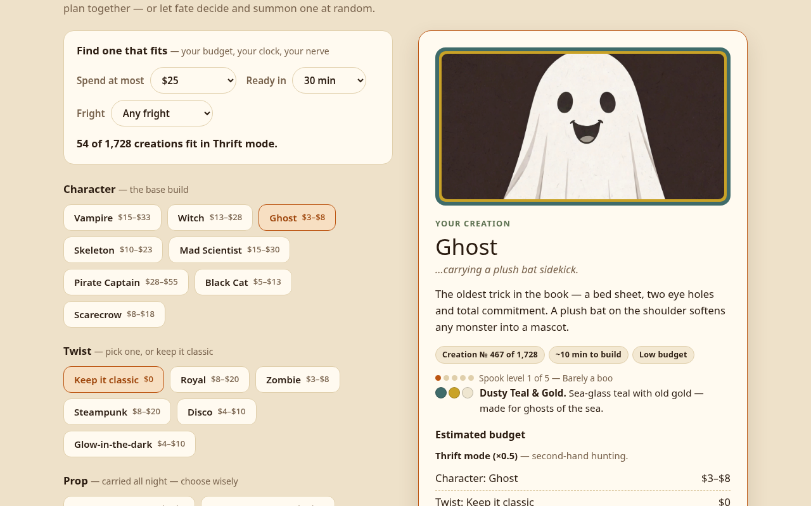

# Halloween Costume Studio

**Tell it your budget, your clock and your nerve. It finds the costume.**

A Halloween costume planner in one self-contained web page: 8 original costumes with full materials lists and methods, a lab that mixes them into 1,728 numbered creations with priced shopping lists, and a finder that searches all of them by budget, build time and fright level.

Built for the **Kiroween 2026** hackathon on Devpost, Costume Contest category.

| Lights on | Lights out | The finder |
| --- | --- | --- |
|  |  |  |

## The problem

It's 5pm on 31 October. You have $25, half an hour and no costume. Costume idea sites give you pictures, not a plan you can afford tonight. Random costume generators give you a name and nothing else.

**Who it's for:** DIY and last-minute costume makers. Students, parents dressing kids, anyone heading to a party who would rather make than buy.

## What it does

- **Costume gallery.** 8 original costumes: Midnight Vampire, Cottage Witch, Sheet Ghost, Bare Bones Skeleton, Mad Scientist, Pumpkin Patch Scarecrow, Ghost Pirate Captain and Black Cat. Filter by vibe (Scary, Funny, Cute, Classic, Last-minute) and sort by spookiness, speed or difficulty. Each costume opens a detail view with materials, a step-by-step method and a "Remix this in the costume lab" button.
- **The Costume Lab.** Mix a character, a twist (Royal, Zombie, Steampunk, Disco, Glow-in-the-dark or classic), a prop and a colour palette. Every one of the 1,728 creations has a number, a generated name, a scare rating, a build time, a merged shopping list, and a per-part and total DIY cost estimate in US dollars. A purchase mode scales the cost: Thrift ×0.5, Buy new ×1.0 or Premium ×1.8. The result opens with the base costume's portrait, framed in the palette you chose.
- **Find one that fits.** Set "Spend at most", "Ready in" and "Fright", and the studio checks every creation in your purchase mode ("54 of 1,728 creations fit in Thrift mode") and summons only from those. When nothing fits, it says so and shows the fix: at $25, buying new, nothing fits, and the studio offers **Switch to Thrift: 54 fit**.
- **Share a creation.** Every creation has an address, for example `index.html#lab=137&mode=thrift`. "Copy link to this costume", Share, Copy plan and Download (.txt) all carry it.
- **Lights out.** A toggle for a haunted dark theme where the spookiness means something: the spook dots burn brighter the scarier the build, a summoned costume materialises out of a blur, and the countdown flickers like a candle. All motion stops if you prefer reduced motion.
- **Countdown to the next Halloween,** computed every year. On 31 October it becomes a **Find a costume for tonight** button that presets $25, 30 minutes and Thrift.
- **Before the night.** Four wearability checks, and a print stylesheet so a plan can go to the shops.

Accessibility: native buttons and selects, `aria-pressed` toggles, visible focus, 42–48px targets, a one-line screen-reader announcement per lab change, reduced-motion support and dark mode. No backend, account, tracking or saved data.

## Run it

Open `index.html` in any modern browser. No build, no install. The only network request is the Google Fonts stylesheet, and system fonts take over offline.

## Test it

```sh
node --test tests/*.test.js     # Node 18+, no dependencies
```

| Suite | What it checks |
| --- | --- |
| `tests/lab-regression.test.js` | All 1,728 creations × 3 purchase modes against a baseline captured before this round of changes (`tests/fixtures/lab-baseline.json`): names, numbers, spook, time, budgets, every cost row, and a digest of descriptions and materials. |
| `tests/lab-properties.test.js` | Seeded property-based tests built on `node:test` alone. Rows add up to totals, Thrift ≤ Buy new ≤ Premium, the mode never changes the costume, materials are de-duplicated, share links round-trip, and loosening a finder limit never lowers the count. Reproduce a run with `PROPERTY_SEED=<n>`. |
| `tests/finder.test.js` | Fit counts against an independent brute force for every selectable limit in every mode, Summon draws, dead-end rescue, the Halloween date roll-over and the Halloween-day button. |
| `tests/share-link.test.js` | Every creation's link round-trips, bad links are ignored, and the address bar and plan text carry the link. |
| `tests/lab-budget.test.js` | Inline-script syntax check and the plan-text budget block. |
| `tests/copy-consistency.test.js` | Hand-typed numbers in the page and in this README (1,728, the 8 costumes, hero stats) match the data, and this README names every Kiro file. |

## How Kiro built this

The first cut (gallery, lab, countdown, licence) was hand-built in the first four commits. **Every change since went through Kiro**, on a branch and merged by pull request. [Commit history](https://github.com/xia-xianyi/halloween-costume-studio/commits/main).

| Kiro feature | Where | What it did |
| --- | --- | --- |
| Steering, always on | [`.kiro/steering/product.md`](.kiro/steering/product.md), [`structure.md`](.kiro/steering/structure.md), [`tech.md`](.kiro/steering/tech.md) | The product rules, the data model and budget data flow, the accessibility and print rules, and how to edit a 5 MB file without touching its base64 lines. |
| Steering, file-matched | [`.kiro/steering/testing.md`](.kiro/steering/testing.md) (`tests/**`) | Testing conventions. Loads only when a test is open. |
| Steering, manual | [`pitch.md`](.kiro/steering/pitch.md) (`/pitch`), [`capture-screenshots.md`](.kiro/steering/capture-screenshots.md) (`/capture-screenshots`) | Keeps the README, page copy and Devpost text on one honest story, and holds the repeatable screenshot and visual-check routine. |
| Specs | [`lab-budget-estimate`](.kiro/specs/lab-budget-estimate), [`lab-budget-modes`](.kiro/specs/lab-budget-modes), [`costume-finder`](.kiro/specs/costume-finder), [`shareable-creations`](.kiro/specs/shareable-creations), [`haunted-studio`](.kiro/specs/haunted-studio) | One spec per feature: EARS-style requirements, a design with trade-offs, and ticked tasks with recorded verification. |
| Plan | [`optimization-plan`](.kiro/specs/optimization-plan/plan.md) | Scored the entry against the judging criteria and ordered this round of work. |
| Hook | [`.kiro/hooks/studio-checks.json`](.kiro/hooks/studio-checks.json) (v1 schema, `PostFileSave`) | Runs the whole suite whenever the page, the README or a test is saved. Its syntax checker, `.kiro/hooks/check-inline-script.js`, is shared with the tests. |
| MCP | [`.kiro/settings/mcp.json`](.kiro/settings/mcp.json) (Playwright) | Real-browser checks of themes, mobile layout, deep links and print, and the screenshots in [`docs/screenshots`](docs/screenshots). |

More: [demo script](docs/demo-script.md) · [Devpost write-up](docs/devpost-writeup.md).

## Built with

HTML · CSS · JavaScript (ES5, no framework) · Node's built-in test runner · Kiro

## License

MIT. See LICENSE.
